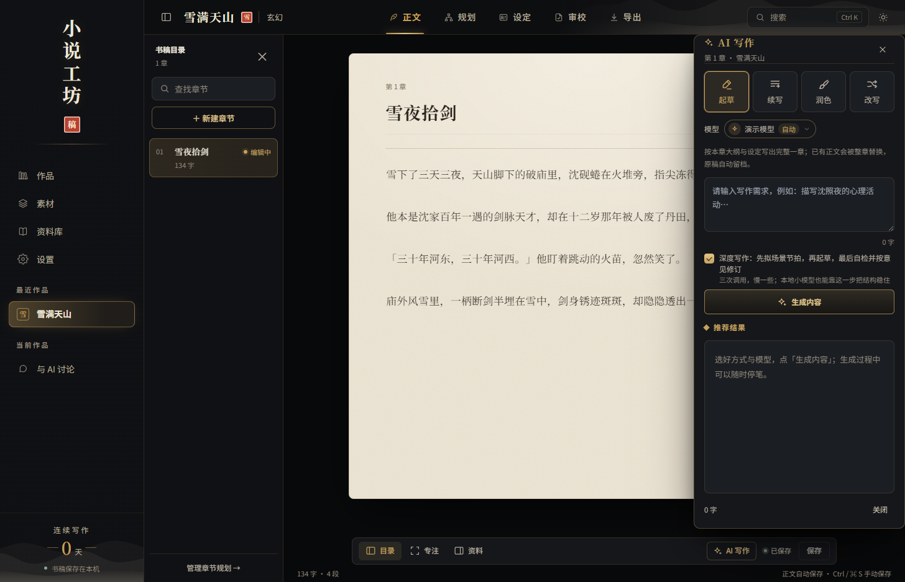

<div align="center">

# 小说工坊 · Novel Writer

**离线优先的本地 AI 长篇小说创作桌面应用**

设定 · 总纲 · 大纲 · 逐章生成 · 精修 · 成书 —— 你的故事与密钥，全部留在自己的电脑里

[](https://github.com/HadenKai/novel-writer/actions/workflows/ci.yml)
[](LICENSE)
[](https://www.electronjs.org/)
[](https://react.dev/)
[](https://nodejs.org/)

[快速上手](#-快速上手) · [功能亮点](#-功能亮点) · [界面预览](#-界面预览) · [配置模型](#-配置-ai-模型) · [开发文档](docs/development.md)

</div>

---

## 界面预览

<table>
  <tr>
    <td width="50%"><br /><sub>书架 · 写作日历 · 码字统计</sub></td>
    <td width="50%"><br /><sub>创作管家 · 与 AI 研讨并直接代改</sub></td>
  </tr>
  <tr>
    <td width="50%"><br /><sub>稿纸编辑器 · AI 写作抽屉</sub></td>
    <td width="50%"><br /><sub>按题材自动推荐名家文风</sub></td>
  </tr>
</table>

## 功能亮点

- **创作管家**：与 AI 对话研讨剧情，可直接代改设定 / 大纲 / 正文，每条改动可撤销；支持联网检索、知识库问答。
- **12 分类 × 3 名家文风**：玄幻 / 仙侠 / 都市 / 言情 / 历史 / 科幻 / 悬疑 / 奇幻 / 游戏 / 现实 / 军事 / 轻小说，每类内置 3 位代表作家（辰东、天蚕土豆、忘语、耳根、猫腻、烽火戏诸侯、刘慈欣、紫金陈、蝴蝶蓝……共 43 位），按**书名 + 简介 + 题材**自动推荐。
- **作者笔性 × 名家自动融合**：写作时实时取样你的亲笔正文，把名家的结构 / 张力 / 画面感与你自己的句式 / 用词 / 节奏融合——成稿像你自己写的，只是技法更成熟，无需任何手动提炼。
- **写作 Agent**：整章重写走「构思 → 起草 → 自检 → 修订」四阶段，本地小模型也能稳住结构。
- **精修四式**：续写 / 润色 / 按问题修改 / 降 AI 痕迹，产物先进预览，作者点「采用」才落正文。
- **参考小说分析 / 拆书**：提取人物 / 事件 / 世界观供同人创作，或逐块逆向结构 / 节奏 / 爽点 / 钩子产出可模仿的拆书报告。
- **成书**：阅读 / 编辑 / 一键排版 / 全书查找替换 / 导出，版本历史可回滚。
- **离线优先 & 隐私**：数据全部存本机；API Key 用系统级 `safeStorage` 加密，绝不入库、绝不进日志。

## 快速上手

### 方式一：下载便携版（推荐，免安装）

到 [Releases](https://github.com/HadenKai/novel-writer/releases) 下载 `NovelWriter-Portable.exe`，双击即用。
首次打开在「模型设置」里填入你自己的中转站地址与 API Key 即可开始创作。

> 未签名的便携版首次运行可能触发 Windows SmartScreen「未知发布者」提示，点「更多信息 → 仍要运行」即可。

### 方式二：从源码运行

```bash
git clone https://github.com/HadenKai/novel-writer.git
cd novel-writer
npm ci

npm run dev      # 仅 Web 端（浏览器 http://localhost:5173）
npm run app      # 桌面端（Electron + 本地服务）
```

### 构建桌面安装包

```bash
npm run app:build   # 产出 nsis 安装版 + portable 便携版（release/）
```

## 配置 AI 模型

支持 **OpenAI 兼容接口**（含各类中转站、Ollama / LM Studio 等本地推理）与 **Gemini 原生接口**。
在「模型设置」添加：名称、地址、模型名、API Key（本地部署可留空）。可为每本书单独指定模型，
并按模型上下文自动裁剪提示词预算，本地小模型也不易撑爆。

## 技术栈

| 层 | 选型 |
| --- | --- |
| 桌面壳 | Electron 31 |
| 前端 | React 18 + TypeScript + Vite + Tailwind CSS |
| 后端 | Express（ESM，无构建直跑）+ Node 内置测试 |
| 存储 | 本机 JSON 文件（原子写 + 备份 + 文件级事务队列） |
| 流式 | SSE 实时增量 + 逐字平滑渲染 |

## 项目结构

```
novel-writer/
├─ electron/        # Electron 主进程（窗口 / 令牌注入 / 打包）
├─ server/          # Express 后端：路由 / 任务系统 / AI 接入 / 预设库
│  ├─ app.mjs       #   路由与后台任务
│  ├─ ai.mjs        #   提示词构建（纯函数）
│  ├─ presets.mjs   #   43 位名家文风 + 12 分类推荐引擎
│  └─ agent/        #   写作 Agent（构思/起草/自检/修订）
├─ src/             # React 前端：页面 / 组件 / hooks / 设计令牌
├─ tests/           # 170 项离线测试（临时数据目录，不调真实 AI）
└─ docs/            # 开发文档与设计文档
```

## 文档

- [开发者指南](docs/development.md) —— 架构、数据存储、API、AI 接入与排查
- [设计系统](docs/design-system.md) · [墨金视觉](docs/ink-design.md) · [编辑方向](docs/editorial-direction.md)
- [写作 Agent 设计](docs/writing-agent.md) · [产品重设计](docs/product-redesign.md)

## 测试与质量

```bash
npm run verify   # 构建 + ESLint + Prettier + 170 项测试
```

所有测试离线运行、使用临时数据目录，不触碰真实 AI 与用户数据。推送 / PR 时 GitHub Actions 自动跑同一套门禁。

## 许可证

[MIT](LICENSE) © Hayden Kai —— 可自由使用、修改、分发与商用。

## 致谢

内置写作技能整理自若干开源小说创作项目（见 `server/skills/` 内的来源标注）；名家文风规则提炼自公开创作谈与同类 AI 写作项目的文风拆解范式。